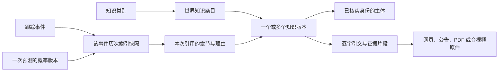

# 世界知识库与事件索引

EvoSight 在同一个工作区维护一个世界知识库。事件贡献新的知识与证据，也可以直接引用其他事件已经核实的材料。例如，“市域线开放”和“无障碍验收”都需要同一份验收公告，两个事件索引分别说明为何采用它，世界库保存一条结论。公告发生在何时、何处可以核对原话，以及哪个事件贡献了每次修订，都随世界条目保存。

## 数据如何组织

内置 10 类知识和 34 个子目录，按条目保存有类型的字段。人与 Agent 可以沿同一目录查到知识，并精确取回某一版的引文。[内容目录、字段协议和选型依据](世界知识目录与Agent检索.md)

| 对象 | 保存的内容 |
| --- | --- |
| 世界知识条目 | 稳定编号、知识类别、当前版本。十类为人物、组织机构、国家与地区、制度与政策、指标与数据、事实与进展、舆情与观点、关系与依赖、分析与假设、背景知识。 |
| 知识版本 | 主体、声明性质、内容、适用时间与精度、结构化属性、引文与原件位置、贡献事件和上一版。逐字引文能定位到网页段落、PDF 页、图片区域或音视频时间。 |
| 共享实体 | 可证实的身份、名称和别名。条目页可以查看同一人物或机构的其他知识。同名对象依据证据中的身份区分。 |
| 事件知识索引 | 条目与版本编号、事件内的章节、引用理由、索引版本。事件独立保存自己的目标、判断、时间线、预测、待查问题和阅读位置。 |

“指标与数据”属于世界库的分类。该指标在一个事件里可以作为背景，在另一个事件里可以作为判断依据。“事实”“公开表态”和“假设”标记知识的性质，人物动因与有条件的判断可同时保留不同解释。演示事件的数据与真实世界知识隔离。

### 哪些对象相互引用

以政策跟踪为例，发布机构具有共享身份。“主管部门发布征求意见稿”和“正式条款已经生效”各自是一条可以被单独核实和引用的陈述。稿件的发布日、条款的生效日和系统首次取得证据的日期各有含义。一次正式发布可以构成新的事实。如果发布方澄清同一项事实的原有表述，相关条目就增加一个修订版本。不同当事人公开表达的观点可以同时保留，各条观点注明发言者、时间与出处。

**人物与舆情的字段随材料类型变化。** 人物身份、公开立场、近期公开行动、与事件有关且已公开的关系分别记录。个人目的和心理动因以分析假设记录，可附替代解释与反证条件。舆情条目保存平台、观察窗口、采样方法、去重后的样本数、主要观点及局限。预测依赖记录观察指标、阈值和影响方向。当前采用 SQLite 统一维护条目、版本、索引及引文，类别筛选和别名检索可以直接从前端使用。[角色字段定义](../evosight/contracts.py)

## 跟踪如何读写世界知识

1. **先检索。** 建档或换目标时，规划器读取事件已有索引，并按主题、实体或别名检索世界库候选。候选进入规划上下文，模型明确选择版本并说明与当前目标的关系。发布方暂不可用时，仍可引用已有可核实材料，原始时间沿用证据记载。
2. **再增补。** 八类角色提交可定位原文。相同声明和证据复用已有版本。新的独立结论建立条目。新材料支持已有结论时，为原条目补充证据。结论改变时，提交有依据的修订。主体、证据或口径不足以认定等价时分别保存。检索命中会产生待评估的候选。
3. **更新索引。** 订正共享条目后，引用它的事件获得新索引版本，首页可查看变化。过去的事件索引、模型输入和概率版本继续指向当时材料。其他事件的结论如何改变，要结合各自目标重新评估。
4. **调整引用。** 目标变更后，规划器可以提出移出已不适用的条目，并记录理由。用户可以固定引用，或将条目从一个事件移出。其他事件的引用和世界条目历史继续可查。用户明确移出的条目可以手工重新加入。

## 从页面核对

侧栏“世界知识库”支持搜索、分类和分页。条目详情显示证据、修订历史、贡献事件及目前引用它的事件。从事件进入“事件知识索引”可比较两个版本，查看具体引用理由，或前往目录选择条目。共享订正在保存前会说明影响范围。

对旧版数据库进行事务迁移。旧声明编号、索引快照编号和预测依据可以继续访问。过去在不同事件内重复保存的相同声明映射到同一世界条目，旧编号继续解析到其历史内容。新的研究成果从写入起就共享同一知识版本。[数据结构](../evosight/workflow.sql) · [检索与版本实现](../evosight/world.py) · [跨事件回放](../tests/test_workflow.py)

## 升级与验收

| 验证对象 | 实测结果 |
| --- | --- |
| 本地工作台 | 原有 3 个事件和 3 道预测完成升级。15 条既有索引引用都可解析。世界目录有 10 条真实资料，另外 4 个条目属于独立的演示数据。 |
| 三个真实试用事件 | Vue、国家统计局和苹果的既有研究迁移为 26 个世界条目，4 个历史索引版本共有 29 条引用。12 张原表的既有记录逐行校验通过，两次启动得到相同结果。 |
| 跨事件订正 | 两个事件引用同一份公告只生成一条当前知识。另一事件补充来源后，当前版本同时保留两方引文。正式订正会更新引用方索引，原预测仍可打开订正前的材料。 |
| 引用与移出 | 用户可以固定研究自动引用的条目，也可独立选择该条目在本事件的章节。再次提交相同选择不会产生新索引版本。规划器遵从固定引用，移出一个事件的引用后仍能在其他事件和旧索引中找到原条目。 |
| 发布方暂时中断 | 规划器可从世界目录选择依据。候选与目标不符时显示待补来源，发布方恢复后可重试并重新检索。历史材料保留原始日期。 |

浏览器使用试用库副本验证。将 Vue 官方候选版本记录加入“前端框架升级评估”的背景后，条目页同时显示两个引用事件。在新事件内点击引文即可打开留存原件的 `Pre-release` 段落。[共享条目画面](../.work/world-browser-01/shared-knowledge.png) · [事件索引画面](../.work/world-browser-01/event-index.png) · [旧库逐表校验](../.work/world-upgrade-20261125-221856/audit.json)

2026-11-26 用 CANNBot 的 Kimi K3.1 Pro 低思考强度完成“Vue 3.6 候选版与前端框架升级评估”研究。在已迁移的试用库副本中，研究阶段只提供留存的公开发布材料。规划器从 8 条候选中选择 5 条，新闻、预测依赖和专项研究三个角色随后核对引文，综合判断完成发布。五次真实模型调用共耗时约 223 秒。[规划结果与引用理由](../.work/world-planner-real/result.json)

新事件的索引最终有 7 条引用，其中 6 条指向既有世界条目，含全部 5 条规划选择。两个既有条目补充引文并升至第 2 版。新建的独立条目记录“Vue 预发布版本 CHANGELOG 的查阅口径”，世界库从 26 条增长至 27 条。规划请求和人工引用均指明采用的版本。如果同一轮研究已经为条目生成新版，索引记录实际采用的版本、研究任务和所在章节。[发布后的索引、逐项引文计数与角色记录](../.work/world-planner-real/publication.json)

四分钟本机回放覆盖服务强制重启、一个已归档事件的到期结算、两事件共享引用和数据库恢复。119 次首页采样的 P95 为 7.49 毫秒，59 张表恢复后一致，未出现悬空引用或指向旧版本的当前索引。[本机回放](../.work/world-soak-smoke-01/final.json)

### Linux 实机长稳

世界知识库构建 `8af55d3f590f` 于北京时间 2026-11-25 22:21:12 开始独立的 24 小时验收，至 11-26 22:21:12 满 24 小时。机器有 2 核 CPU、1.83 GiB 物理内存，本构建进程组的内存上限为 1.25 GiB。两次验收在同一主机分别使用独立的进程组、数据库和回环端口，部分时段重叠。发布方和模型提供固定回复，实际运行调度、HTTP 服务、SQLite 事务和恢复逻辑。[构建清单](../.work/server-release-8af55d3f590f/manifest.json) · [最近一次采样](../.work/server-release-8af55d3f590f/status.json) · [早先构建的工作流基线](工作流初版验收记录.md)

### 实际运行结果

北京时间 2026-11-26 22:21:25 完成长稳验收，实际运行 86,413 秒，完成 4 个连续的六小时窗口。模拟重大公告从发布到入队耗时 461 秒。断源后补回 1 个来源窗口，最终待办 0 项、失败任务 0 项、未完成研究角色 0 项。两道题各结算一次，其中 1 道在事件归档后到期，重复结算 0 次。

2,880 次首页采样的 P95 为 15.29 毫秒。任务从创建到开始执行最长 11919 秒，统计包含等待重试的时间。服务进程内存峰值 72.5 MiB，整个验收进程组峰值 94.3 MiB，内存耗尽导致的终止 0 次。SQLite 恢复副本的 59 张表行数一致，完整性、外键及证据原件 SHA-256 核验通过。[长稳报告](../.work/server-release-8af55d3f590f/final.json) · [逐次采样](../.work/server-release-8af55d3f590f/metrics.jsonl)

两个事件当前共同引用 1 条世界知识。共有 3 个条目和 3 个版本。失效引用 0 个，当前索引滞后引用 0 个。
